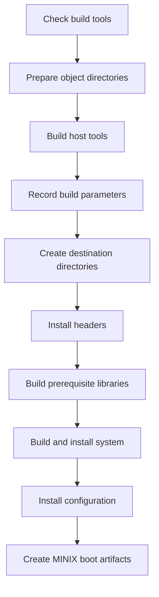

# MINIX Source Development and Build Guide

This guide is for developers learning how a complete operating system is
assembled from source. It follows the source tree and its build dependencies;
it is not an end-user guide to configuring or operating an installed system.

MINIX in this repository is not a small, self-contained teaching kernel. It is
a complete system built on a large NetBSD-derived source and build framework,
with MINIX-specific kernel, servers, drivers, libraries, commands, and release
tools. The best way to learn it is to follow one real build and then trace one
change through the components that own it.

## How to Use This Guide

Read the build pipeline first, then use the source map to choose a subsystem.
For each change, follow the same loop:

1. Find the owning source and its nearest `Makefile`.
2. Trace its headers, libraries, generated inputs, and consumers.
3. Build the smallest affected target, then build the whole system when the
   change crosses subsystem boundaries.
4. Test in an isolated virtual machine or other disposable target.
5. Record what you learned in the subsystem's existing documentation or tests.

The exact options and supported platforms can vary by branch and machine.
Treat the Makefiles and configuration in this checkout as the authority for
the build you are doing.

## The Repository in One Picture

The source tree combines shared infrastructure with MINIX-specific code.

| Area | Role |
| --- | --- |
| `tools/` | Programs built to run on the build host and used by later build stages. |
| `share/mk/` | Make rules used throughout the source tree. |
| `include/`, `lib/`, `common/` | Shared interfaces, libraries, and code used by multiple components. |
| `sys/` | Machine-dependent kernel and boot-related infrastructure inherited from the NetBSD source layout. |
| `minix/kernel/` | The MINIX kernel and architecture-specific kernel code. |
| `minix/servers/`, `minix/fs/`, `minix/drivers/`, `minix/net/` | User-space system servers, file systems, drivers, and networking. |
| `minix/lib/`, `minix/include/` | MINIX-specific library code and interfaces. |
| `bin/`, `sbin/`, `usr.bin/`, `usr.sbin/`, `minix/commands/` | Commands and administration programs. |
| `etc/` | System configuration, installation rules, and build configuration. |
| `distrib/`, `releasetools/` | Distribution sets and bootable/release artifacts. |
| `tests/`, `minix/tests/`, `regress/` | Shared and MINIX-specific tests, where enabled. |

This division is not a strict ownership boundary. A shared library may include
MINIX-specific source, and a MINIX component may depend on headers or build
rules outside `minix/`. For example, the shared libc build includes MINIX
sources through `lib/libc/Makefile.inc` and
`minix/lib/libc/Makefile.inc`.

## Build Pipeline

The top-level `Makefile` defines the authoritative `build` sequence. In broad
terms it checks tools, prepares object directories, builds host tools, records
build parameters, creates destination directories, installs headers and
libraries, builds the system, and then installs configuration and MINIX boot
artifacts. The ordered target list is in the root [Makefile](Makefile).

The sequence has two important consequences:

- A host tool is a program that runs during the build on the build machine. It
  is distinct from a target program that will run on MINIX.
- `DESTDIR` is the staging/install destination, not the source tree. Some
  targets, especially the MINIX `build` target, install files and create boot
  artifacts. Always inspect the effective destination before building.

At the top level, `make build` is the primary full-build target in this tree.
The MINIX-specific `world` target is retained for compatibility and explicitly
warns that it is obsolete. `buildworld` is the guarded alternative when you
want to require a non-root staging destination; the Makefile rejects it if
`DESTDIR` is unset, empty, or `/`. See the target definitions in the root
[Makefile](Makefile).

The `build.sh` script is inherited from the NetBSD build system and documents
its own wrapper interface. Before relying on its options, check whether the
current branch and host workflow use it or invoke the top-level make targets
directly.

## Before the First Build

1. Read the repository's build and update notes, especially
   [`docs/UPDATING`](docs/UPDATING), for branch-specific prerequisites and
   migration warnings.
2. Confirm that the host has the expected compiler, shell, utilities, and BSD
   make environment for this checkout. Do not assume GNU make is interchangeable
   with the make implementation expected by the source framework.
3. Inspect the active build settings and machine selection. The root Makefile
   provides `show-params`; its output is a useful record of the selected
   `MACHINE`, `MACHINE_ARCH`, tool directory, object directory, and feature
   options.
4. Choose an explicit staging destination for cross-builds and experiments.
   Check it before invoking a target that installs files. Do not point an
   experimental build at a host's live root filesystem.
5. Ensure the source tree and destination have enough storage for generated
   objects, tools, and the staged system. Keep source and object directories
   separate when the configuration supports it.

Build settings are resolved through the make framework and configuration
files, not just command-line flags. Start with the top-level `Makefile`,
`etc/mk.conf`, `share/mk/bsd.own.mk`, and the applicable machine-specific
Makefiles when a setting is surprising.

## Build in Stages

### 1. Understand the build configuration

Start with the root `Makefile` and `Makefile.inc`, then inspect the target's
own Makefile. MINIX-specific behavior is often selected with `__MINIX`; machine
and architecture behavior is commonly selected with `MACHINE` and
`MACHINE_ARCH`. Object directories hold generated files so that a source tree
can be built without mixing target objects into source directories.

The root build has explicit ordering constraints. `tools` must be ready before
later targets use them, headers precede libraries, and libraries precede
programs that link against them. MINIX is entered after shared prerequisites
in the root subdirectory sequence. Within `minix/`, the Makefile puts headers
first, waits before drivers, and builds drivers last because the ramdisk
depends on other drivers.

### 2. Build the host tools

The build creates or updates programs under `tools/` that are needed to
generate or transform target files. When a build fails, first identify whether
the failing executable is a host tool or a target executable. A host/target
confusion can look like a compiler or runtime bug even though the wrong binary
was selected.

### 3. Generate headers and build libraries

Headers establish interfaces between independently built components. Some
headers are copied or installed into the staging tree; others are generated
from source data or build-time probes. Libraries then provide shared code and
system-call interfaces to commands, servers, and drivers.

The MINIX kernel Makefile demonstrates this dependency work: it adds
architecture-specific include paths, links system libraries, uses a
machine-specific linker script, and generates extracted headers from errno,
IPC message fields, and message types. If a generated header is stale or
missing, inspect its generating rule and prerequisites before editing the
generated output.

### 4. Build the MINIX-specific system

The MINIX portion is ordered by [`minix/Makefile`](minix/Makefile):

| Subtree | What to investigate |
| --- | --- |
| `minix/include/` | Public and internal interfaces shared by MINIX components. |
| `minix/kernel/` | Kernel entry, process and interrupt handling, architecture code, and linking. |
| `minix/servers/` | System servers, including process management, scheduling, VM, VFS, and reincarnation service. |
| `minix/fs/` | File-system implementations and their server interfaces. |
| `minix/drivers/` | Device drivers and their build/configuration rules. |
| `minix/net/` | MINIX networking components. |
| `minix/lib/` | MINIX-specific runtime, IPC, and system libraries. |
| `minix/commands/`, `minix/sbin/`, `minix/usr.bin/`, `minix/usr.sbin/` | MINIX-specific userland programs. |
| `minix/tests/` | MINIX tests, included when the build enables ATF. |

The server list in [`minix/servers/Makefile`](minix/servers/Makefile) gives a
useful initial map. The kernel's own build rules are in
[`minix/kernel/Makefile`](minix/kernel/Makefile). These are starting points,
not complete descriptions of runtime relationships.

### 5. Stage configuration and create boot artifacts

System configuration is part of the built system: it selects and configures
components that cannot be understood from the kernel source alone. Follow the
configuration inputs under `etc/`, the installation rules in `etc/Makefile`,
and the MINIX boot/release rules under `releasetools/`. The root `build` target
installs a safe set of `/etc` files and invokes the MINIX hard-disk boot target
after the main build stages.

Separate these outputs when debugging:

- compiled objects and executables;
- files staged under `DESTDIR`;
- distribution sets and release archives;
- disk or virtual-machine boot images.

A successful compile does not prove that the staged tree, boot configuration,
or boot image is correct.

## From Boot to Services: A Reading Path

To understand the system as a running OS, trace the handoffs rather than
reading every source file in a directory:

1. Find the architecture's boot and kernel entry code under `sys/` and
   `minix/kernel/arch/`. Identify what state the loader passes to the kernel.
2. Follow kernel initialization from `minix/kernel/main.c` into process,
   interrupt, and system-call setup. Compare architecture-specific setup with
   common kernel code.
3. Inspect the system configuration and the Reincarnation Server (RS) startup
   path to learn which services and drivers are launched and supervised.
4. Trace one IPC request across a client library, a server, and any kernel
   operation it needs. Keep message definitions and syscall stubs beside the
   implementation while reading.
5. Follow a filesystem operation through VFS and the selected filesystem
   server; follow a device operation through the responsible driver.
6. Inspect shutdown, restart, and error paths as well as the successful path.
   Service recovery and process isolation are part of MINIX's architecture,
   not just operational details.

Use `etc/system.conf`, `minix/servers/rs/`, `minix/servers/vfs/`,
`minix/kernel/`, and the relevant driver or filesystem directory as the first
navigation points. Verify the active startup path in this checkout before
assuming a particular service sequence.

## Learning Exercises

These exercises make the build graph concrete without requiring a broad rewrite.

### Trace a command

Choose a small command in `bin/` or `minix/commands/`. Find its Makefile, list
its library dependencies, identify the install destination, and locate the
test or manual page. Follow the program from source to its staged path.

### Trace a system call

Pick a simple call used by a command. Find its public declaration, libc stub,
message or request definition, server-side handling, and kernel-facing path.
Record which pieces are generated and which are hand-written. This exposes the
interface contracts that a syscall change must preserve.

### Trace a driver

Choose a driver and follow its build rule, startup configuration, IPC protocol,
and interactions with the kernel. Identify which process owns hardware state
and which failures are handled by RS or another server.

### Make a safe build-only change

Change a comment or a harmless build input in a leaf target, then build that
target and confirm the output lands in the expected object or staging
directory. This tests your host tools, make environment, and object-directory
configuration before you change runtime behavior.

### Make a runtime change

Change one isolated behavior, add or update a focused test, rebuild the affected
component, then build the complete system if interfaces or shared libraries
changed. Boot the staged result in a disposable VM and keep the build log and
configuration alongside the test result.

## Tests and Debugging

Use the narrowest test that exercises the changed behavior, then broaden
validation according to the change's reach. The root Makefile has a
`regression-tests` target when the regression tree is present. MINIX tests are
conditional on `MKATF`; inspect `minix/Makefile`, the relevant test Makefile,
and the selected build parameters to determine whether they are included.

When a build fails, classify the failure before changing code:

- **Configuration:** wrong machine, architecture, feature option, or
  destination. Recheck `show-params` and the relevant make configuration.
- **Host tool:** a tool failed while running on the build machine. Check the
  host tool build and host/target selection.
- **Generated input:** an extracted header, generated source, or downloaded
  source is missing or stale. Find the rule that creates it and inspect its
  prerequisites.
- **Compile or link:** inspect include ordering, architecture conditionals,
  library dependencies, and linker scripts in the owning Makefile.
- **Install or image:** confirm the executable was built, the expected staged
  path exists, and the install/image target consumed that path.
- **Boot or runtime:** keep compiler output separate from kernel logs and
  service logs. Confirm the VM actually booted the image you just built.

Some GNU sources are fetched during MINIX builds instead of being stored in
this source tree. The conventions and cleanup behavior are documented in
[`minix/Makefile.fetchgnu`](minix/Makefile.fetchgnu). A missing external
source may therefore be a fetch/configuration issue rather than a compile
failure.

## From Build Tree to Release

The build destination is not the same thing as a release. Release engineering
adds validation and packaging steps: distribution sets, file lists, boot
images, and release metadata. Inspect `distrib/`, `releasetools/`, and
`etc/Makefile` for the exact targets in this checkout. The root Makefile
documents release-related targets and their prerequisites; use those rules
rather than manually copying files into an image.

Before testing or sharing a release artifact, verify at least:

- the intended machine and architecture were built;
- all expected binaries and configuration files are in the staged tree;
- release-set checks complete successfully;
- the generated image boots in the intended virtual or physical environment;
- the test result corresponds to the same source revision and build settings.

## A Practical Order for Learning the Codebase

1. Read the root `Makefile`, `share/mk/bsd.own.mk`, and one small leaf
   Makefile to understand recursion and build variables.
2. Build a small user program and inspect its object and staged outputs.
3. Read the MINIX IPC and library interfaces used by that program.
4. Trace one server request through VFS, a filesystem, or a device driver.
5. Read the kernel path involved in that request and its architecture-specific
   implementation.
6. Follow system configuration, service startup, and recovery behavior.
7. Build, package, and boot the full system; then use tests to validate a
   small change end to end.

This order moves from the visible build rules toward the less visible runtime
contracts. It also keeps the scope manageable: MINIX can be studied as a
sequence of interfaces and dependency edges, not as one enormous code-reading
exercise.

## Useful Starting Points

- [Top-level build orchestration](Makefile)
- [Top-level build variables](Makefile.inc)
- [MINIX build ordering](minix/Makefile)
- [MINIX kernel build rules](minix/kernel/Makefile)
- [MINIX server inventory](minix/servers/Makefile)
- [GNU source fetch rules](minix/Makefile.fetchgnu)
- [Build update notes](docs/UPDATING)
- [Build wrapper](build.sh)